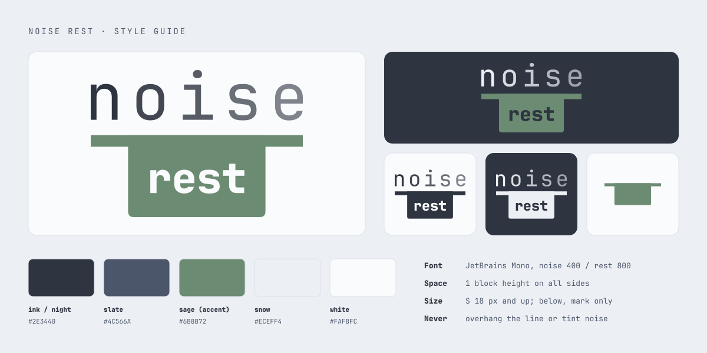

# Brand Assets for [Noise Rest](https://noise.rest)



1. [Usage guide](exploration/14-usageguide.html): clear space, minimum sizes, colour versions, don'ts.
2. [`svg/logo.svg`](svg/logo.svg): the primary logo. Other versions are in [`svg/`](svg/).
3. [`design/tokens.json`](design/tokens.json): colours, font and logo geometry. Change the accent here, then rebuild.

## Rebuild

Needs Python with [fontTools](https://github.com/fonttools/fonttools) and [ImageMagick](https://imagemagick.org). Run in order:

```sh
python3 tools/outline.py     # tokens + fonts -> svg/
python3 tools/rasterize.py   # svg/ -> png/, favicon.ico
python3 tools/styleguide.py  # tokens + svg geometry -> docs/styleguide.svg
```
